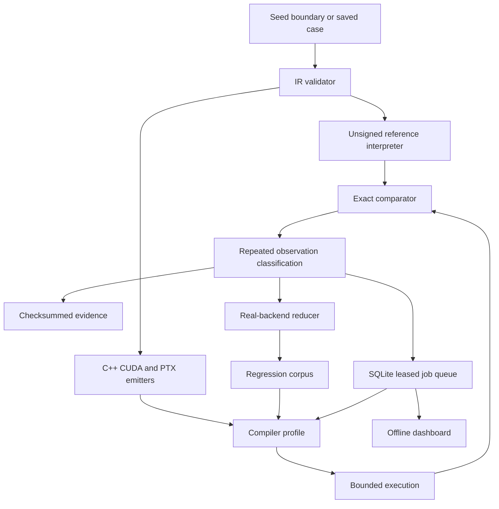

# Implemented system architecture

This document describes the delivered implementation, replacing the earlier build roadmap. The project targets the compiler-verification role's C++/CUDA/PTX test development, Python automation, language semantics and reliability requirements.

## Data flow

## Supported semantics

Each case has `schema`, `kind`, `inputs` and `ops`. An operation is a two-element list of opcode and constant. Values are uint32. Arithmetic wraps modulo 2^32; shifts have legal counts; reductions use modular addition. Cases are limited to 4096 inputs and 256 operations. This bounded scope makes an executable oracle practical.

The language deliberately excludes floating point, arbitrary pointers, signed-overflow cases and unconstrained parallel programs. These are not unfinished branches in the implementation. They are outside the verified semantic subset.

## Backend contracts

| Backend | Build path | Execution path |
|---|---|---|
| cpp | GCC/Clang-compatible command to native binary | Child process with numeric stdout |
| cuda | nvcc runtime executable | Child process with device synchronization |
| ptx-jit | nvcc device source to PTX | Driver API module load and JIT |
| ptx-cubin | nvcc to PTX, ptxas to cubin | Driver API module load |
| ptx-direct | Hand-authored integer PTX emission | Driver API module load and JIT |
| model | No native compilation | Explicit harness-only execution |

Compiler profiles are argument arrays; no shell construction is used for compiler commands. The configured compiler executable is hashed, its version is captured, and a changed binary invalidates a resumed campaign. A profile can select an installed compiler release by absolute path. Different profiles are independently compared against the same oracle.

The report records generated sources, case identity, profile, host platform, executed commands, stdout/stderr, elapsed time, repeat observations and artifact hashes. GPU reports additionally record device name, compute capability and driver version. This is substantial provenance, but it does not fingerprint every library, header or transitive toolchain file. Claims of perfectly hermetic reproduction would be too strong.

## Reliability and persistence

SQLite stores immutable job payloads, current ownership, lease expiry, attempt count, result JSON and artifact location. Enqueue is idempotent. Initial population is replayed idempotently during resume so interruption during setup cannot silently omit jobs. Resume rejects a changed engine or compiler binary.

Each worker claims a job transactionally and renews its lease. Attempts write into separate folders. Conditional completion protects against stale ownership. Three abandoned attempts produce INFRASTRUCTURE_ERROR. Completed jobs are not executed again during a normal resume.

The worker pool is local and uses threads to coordinate subprocesses. SQLite is not exposed over a network. Remote task distribution, authentication and multi-tenant sandboxing are not part of this application.

## Triage and reduction

PASS requires exact agreement under the supported specification. Protocol errors, compilation diagnostics, compiler crashes, execution errors, timeouts, output limits, sanitizer findings and unavailable capabilities have distinct statuses. Stable disagreement is WRONG_RESULT; differing repeated observations are FLAKY_RESULT.

Reduction deletes operations and inputs while retaining a repeated WRONG_RESULT on the selected backend. A budget bounds work. The final report distinguishes a completed deletion fixed point from budget exhaustion. The regression workflow checks saved expected outputs and runs the corrected configuration.

## CUDA correctness design

Map kernels give each thread its own output lane with a bounds check. Reduction kernels use one block of 128 threads, initialize all shared-memory lanes and put every barrier outside the participating-lane conditional. Unsigned modular addition makes the chosen reduction order semantically exact for this suite.

Compute Sanitizer profiles are provided for memory access, initialization, shared-memory hazards and synchronization. A nonzero sanitizer finding code is distinct from application failure. Sanitizer success would still not prove general race freedom or compiler correctness. [NVIDIA Compute Sanitizer](https://docs.nvidia.com/compute-sanitizer/ComputeSanitizer/index.html)

NVCC provides PTX and cubin-related compilation phases, which the adapters expose separately. The offline path invokes ptxas explicitly; the JIT path sends saved PTX to the driver. [NVIDIA NVCC documentation](https://docs.nvidia.com/cuda/cuda-compiler-driver-nvcc/index.html)

The Driver API worker binds module loading, memory allocation, launch and synchronization using ctypes. [CUDA Driver API guide](https://docs.nvidia.com/cuda/cuda-programming-guide/03-advanced/driver-api.html)

The handwritten microtests use PTX unsigned arithmetic and logical-shift instructions with a declared PTX version and target. [PTX instruction set](https://docs.nvidia.com/cuda/parallel-thread-execution/)

## Delivery and operational use

The Windows bundle contains a pinned Zig 0.14.1 distribution and its license material. It supplies a Clang-based C++ driver without changing system installations. The bootstrap checks the official archive's SHA-256. [Official Zig downloads](https://ziglang.org/download/)

The source package runs on Python 3.10+ with a system GCC/Clang compiler. A CPU Dockerfile and CI workflow exercise the same commands; the GPU workflow is manually triggered on a configured self-hosted runner. They have not been dispatched as part of local validation.

For a Jetson device, use the installed compatible toolkit and driver with `configs/jetson.json`. The detected architecture determines nvcc's target. This is implemented configuration support, not a claim of executed embedded validation.

## Role alignment

| Role requirement | Delivered evidence |
|---|---|
| Strong C/C++ | Generated, compiled, executed programs with explicit unsigned semantics and retained source |
| Python | Modular orchestration, persistence, CLI, tests, reduction and reporting |
| CUDA/PTX | Kernel emitters, shared-memory reduction, PTX microtests and driver/runtime adapters |
| Language specification | Constrained IR, validation, exact oracle, boundary and metamorphic checks |
| Compiler automation | Profiles, repeated execution, resumable campaigns and CI configuration |
| Robustness across releases | Configurable compiler paths, binary identity checks and reusable regression cases |
| Parallel programming | Local worker coordination and CUDA kernels with explicit ownership/barriers |

Consult VALIDATION.md for exact measured results and hardware limitations.
